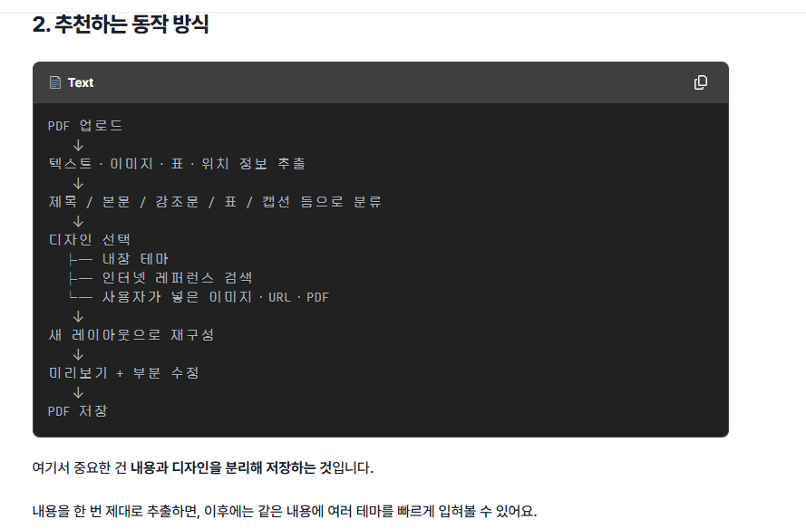
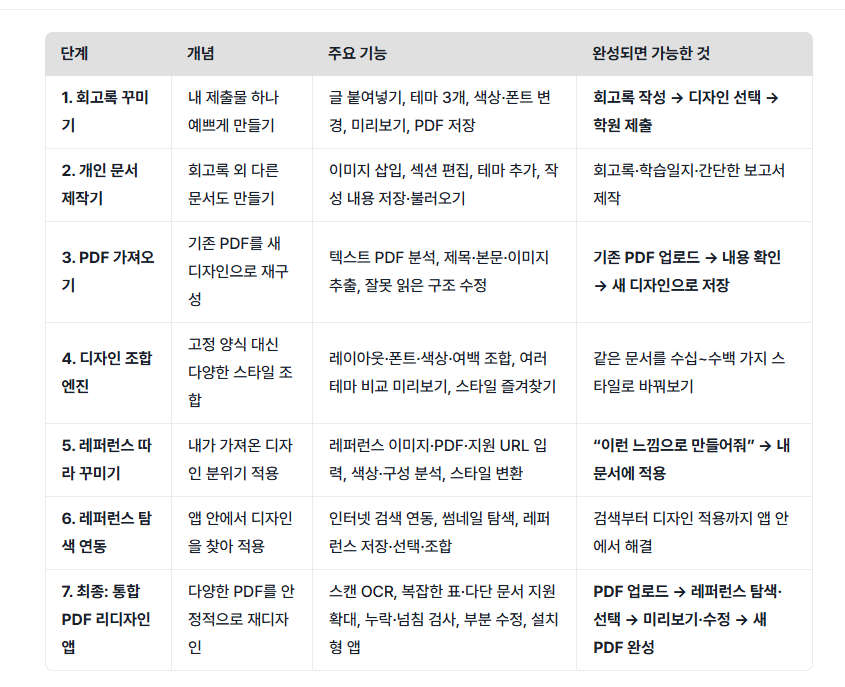

# Astra PDF Redesigner — 원본 설계 참고

이 문서는 사용자가 제공한 설계 이미지 두 장을 **변형 없이** 참조하고 설명한다.

- 원본 개발 로드맵: [ASTRA_ORIGINAL_ROADMAP.txt](ASTRA_ORIGINAL_ROADMAP.txt)
- 단계별 상세 범위와 제약은 원본 로드맵 문서를 우선한다.
- 개념: PDF 업로드 → 텍스트·이미지·표·위치 정보 추출 → 제목·본문·강조문·표·캡션 분류 → 디자인 선택(내장 테마 / 인터넷 레퍼런스 / 사용자 이미지·URL·PDF) → 새 레이아웃 재구성 → 미리보기·수정 → PDF 저장.
- 핵심 설계 원칙: **내용(원문)과 디자인(스타일 설정)을 별개로 저장하고, 테마 변경 시 원문을 변경하지 않는다.**
- 로드맵 1~7: 회고록 꾸미기 → 개인 문서 제작기 → PDF 가져오기 → 디자인 조합 엔진 → 레퍼런스 따라 꾸미기 → 레퍼런스 탐색 연동 → 통합 PDF 리디자인 앱.
- STEP 1에서는 PDF 가져오기, 외부 레퍼런스, AI, 검색, OCR을 **구현하지 않는다**.
