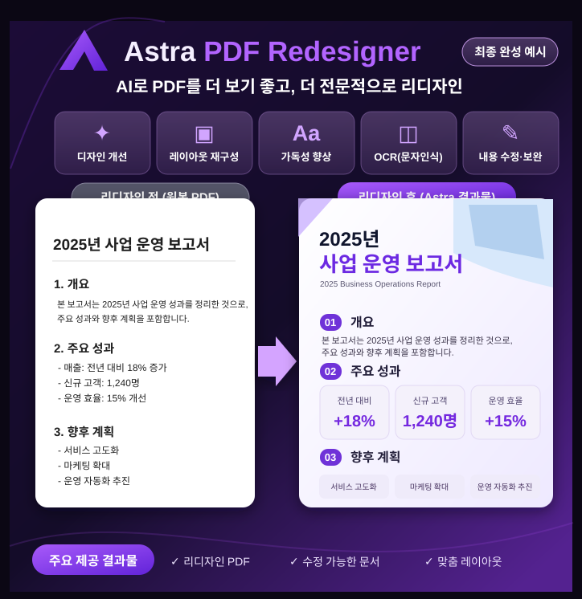

# Astra PDF Redesigner — 사용자 선택 디자인 레퍼런스 (2026-11-15 KST)

> **상태: DESIGN REFERENCE / 시안** — 소프트웨어 구현 완료·사용자 수용·OCR 작동·상용 판매를 인증하는 문서가 아니다. 사용자가 2026-11-15 ChatGPT에서 생성한 Astra PDF 제품 예시 이미지를 보고 “디자인 좋네, 참조할 레퍼런스로 해당 레포지토리에 공시”하도록 지시한 내용을 기록한다.

## 디자인 레퍼런스

- **원본 사용자 선택 이미지:** 이번 대화 첨부 `image(20261115-050239).png`, 724×746px, SHA-256 `06441f6258716f43d20f5ba10b2937a1cf0d2156e803ea9c5375dbf9f1a441c3`.
- **GitHub 저장 파일:** `astra-pdf-visual-reference-20261115.svg` — *선택 시안을 코드로 재구성한 개념도*이며, 원본 PNG 픽셀/레이어 복제가 아니다. 원본 PNG 파일은 이 커밋에 포함되지 않았다.
- **용도:** 최종 웹/데스크톱 UI 고도화, 디자인 테마, 마케팅 상세페이지의 **미감·레이아웃 참고**. 확정된 기능 요구사항·현재 구현 상태보다 우선하지 않는다.

## 이미지에서 추출한 목표 디자인 요소

1. **브랜드:** 상단 왼쪽 입체감 있는 보라색 A 심볼, 두꺼운 흰색·보라색 `Astra PDF Redesigner` 타이포. 제목 아래 짧은 한국어 제품 가치 설명.
2. **톤:** 거의 검정에 가까운 딥 퍼플 배경, 은은한 보라색 빛/그라디언트, 둥근 유리 질감 기능 카드, 높은 명도 대비, 화이트 문서 캔버스.
3. **정보 구조:** 상단 브랜드/핵심 약속 → 가로 5개 핵심 기능 카드 → **원본 PDF vs 리디자인 결과물** 나란히 비교 → 하단 결과물/핵심 약속.
4. **시각적 증거:** 변환 전은 텍스트 중심의 단순한 A4 보고서, 변환 후는 제목 계층·섹션 번호·성과 KPI 3개·인포그래픽·업무 계획 카드가 정돈된 보고서. 중앙 화살표로 전후 변화를 즉시 이해.
5. **라운드/타이포:** 큰 헤더 700~800 weight, 한글 라벨 선명함, 카드/버튼 10~18px 둥근 모서리, 과도한 장식 대신 주요 계층에만 보라색 강조.
6. **추천 디자인 토큰(추정·조정 가능):** background `#140C29`, deep surface `#1C0C37`, purple `#7428DF`, highlight `#B264FF`, text `#F5EFFF`, document `#FFFFFF`. 비율·색값은 스크린샷에서 수동 추정한 가이드이며 원본 레이어 데이터가 아니다.

## 구현 시 지킬 경계

- 이 이미지는 **최종 제품 콘셉트**이며 이미지 상의 `AI`, `OCR`, `수정 가능한 원본` 등 카피가 실제 기능 구현·검증·구매자 납품을 증명하지 않는다. 확인된 기능만 제품 내부·크몽 상세페이지에서 명시한다.
- 최종 사용자 요구는 `REQUIREMENTS.md` 및 원본 7단계 로드맵이다. 문장·숫자·이미지·표의 *콘텐츠 보존*이 우선이며, 시각적 미감 때문에 원본 데이터를 요약·재작성·누락하지 않는다.
- **두 종류를 분리:** (A) 웹사이트/앱의 제품 UI 디자인; (B) PDF 출력물의 A4 레이아웃 디자인. 마케팅용 before/after 이미지를 실제 데이터 편집 화면으로 오인하지 않는다.
- 기존 8개 레이아웃, 편집/저장/가져오기, PDF 대조/검수/인쇄, IndexedDB·localStorage 스키마와 복구 절차를 무단 변경하지 않는다.
- 화면 작업은 실제 사용 가능한 컴포넌트·반응형·키보드/접근성·오류 상태를 포함한다. A4 출력은 실제 한국어 긴 문서·표·이미지 경계·페이지 분할 테스트가 필요하다.
- 디자인 적용/코드 수정/브랜치 병합/Production 배포/상품 출시 및 비용 발생은 이 레퍼런스 등록과 별개다. 승인된 범위와 테스트를 지킨다.

## 수용 검토 체크리스트 (향후 개발 시)

- [ ] 전/후 비교 흐름이 처음 보는 구매자에게 3초 안에 이해되는가
- [ ] 딥 퍼플/화이트 대비와 두꺼운 제목 계층이 반응형 환경에서도 유지되는가
- [ ] 기존 앱 기능·단축키·저장 데이터·출력 결과 회귀 없음
- [ ] OCR/AI/문서 수정 등 실제 없는 기능을 이미 작동하는 것처럼 표현하지 않음
- [ ] 합성 샘플 기준 실제 A4 PDF 출력, 이미지/표/한글 문단 및 내용 대조 검증

**적용 상태:** 레퍼런스만 등록. 기존 애플리케이션 소스 수정 0건, CI/실사용/Production 재검증 미실시, 출시 승인 없음.
